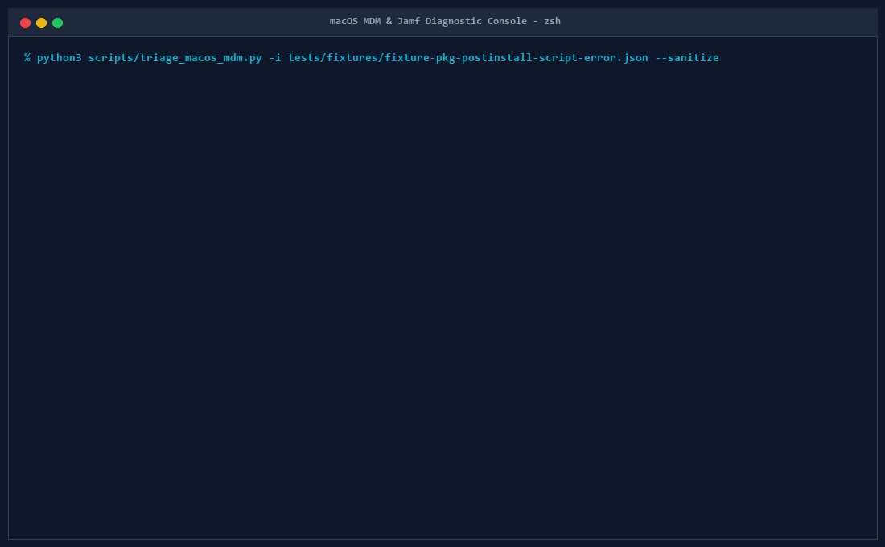

# macOS MDM & Jamf Profile Troubleshooter (`macos-mdm-triage`)



[](https://github.com/ToritsejuBoyo/macos-mdm-triage/actions/workflows/tests.yml)
[](LICENSE)
[]()
[-brightgreen.svg)](CONTRIBUTING.md)
[](SECURITY.md)
[](https://agentskills.io)

> An HD recording is available in [`assets/demo.mp4`](assets/demo.mp4).

Deterministic, read-only macOS MDM, Jamf Pro, and Apple Package (`.pkg`) triage engine and AI agent skill. Analyzes `/var/log/install.log` PackageKit error codes, Apple configuration profile rejections (`-20108`, `-20109`, `-20110`), APNs push channel timeouts, Apple Silicon Bootstrap Token escrow, and PPPC/TCC security architecture from sanitized telemetry.

Zero third-party dependencies. Standard macOS Bash and Python standard library only.

---

## 1. Executive Summary & Stakeholder Briefing

### The One-Sentence Pitch
A zero-dependency, read-only diagnostic engine and agent skill that transforms cryptic macOS `/var/log/install.log` errors, failed Jamf `.pkg` deployments, and rejected MDM configuration profiles into instant root cause diagnoses, administrator remediation playbooks, and pre-formatted ITSM escalation tickets.

### The Real-World Problem
In enterprise mixed fleets running macOS Sequoia, Sonoma, and Ventura, Mac endpoint management poses unique operational friction:
1. **The `/var/log/install.log` Needle in a Haystack:** When a Jamf, Intune, or Kandji software package deployment fails, end users see a generic "Installation Failed" message. Technicians spend 30 to 45 minutes SSHing or screen-sharing into the endpoint to grep through tens of thousands of lines in `/var/log/install.log` to determine if the failure was an expired Developer ID certificate, a quarantine gatekeeper block, a postinstall script exit code 1, or APFS storage exhaustion.
2. **Silent MDM Configuration Profile Rejections:** When an Apple configuration profile fails to deploy, macOS reports obscure CoreOS error codes (e.g. `-20108`, `-20109`, `-20110`). IT technicians waste hours before realizing that the payload required Apple Device Supervision (Automated Device Enrollment / ADE via Apple Business Manager), clashed with an existing payload identifier, or was missing User Approved MDM (UAMDM).
3. **Escalations Without Telemetry:** Tier 1 help desk technicians frequently escalate Mac deployment failures to Tier 3 Mac Engineering with vague notes, lacking error domains, certificate serials, or supervision states.

### The 3-Step Walkthrough
1. **Run Read-Only Collector:** The technician or user runs a single lightweight script (`collect-macos-mdm.sh` on macOS or `collect_macos_mdm.py`). It captures configuration profile states, recent `install.log` errors, APNs status, and daemon health in under 3 seconds.
2. **Execute Deterministic Triage:** The engine evaluates the telemetry bundle against a 6-domain decision tree: MDM Enrollment -> Profile Supervision -> PackageKit Logs -> Agent Daemons -> Security Architecture (SIP/UAMDM/PPPC).
3. **Receive Instant Diagnosis & Escalation Ticket:** The tool outputs a clear plain-English root cause, user self-service steps, an administrator remediation playbook, and a pre-formatted Jira/ServiceNow escalation ticket.

### Why IT Leadership Approves (CISO & Mac Fleet Operations)
- **100% Read-Only & Non-Destructive (Rule 3):** Standard built-in macOS queries (`profiles status`, `profiles list`, `launchctl list`, `spctl`, `csrutil`, `/var/log/install.log`). Zero profile removals, zero package installations, and zero system mutations.
- **Client-Side Data Sanitization (Rule 4):** Automated `--sanitize` mode masks hardware serial numbers (SHA-256 hashed to `C02XXXXXXXX`), Mac hostnames (`mac-xxxx.corp.example.com`), usernames, and corporate MDM URLs before telemetry touches an LLM.
- **Zero Third-Party Dependencies (Rule 3):** Built entirely in native Bash and Python standard library (`json`, `subprocess`, `hashlib`, `platform`, `argparse`, `re`, `time`). No `pip install`, no Homebrew formulas, and zero EDR/Defender security alerts.
- **Multi-MDM Vendor Compatibility:** Works uniformly across **Jamf Pro / Jamf Now**, **Microsoft Intune**, **Kandji**, **Addigy**, **Mosyle**, and Apple native MDM.

---

## 2. Why This Is Fundamentally Better Than What Exists

| Evaluation Dimension | Traditional Screen-Sharing / SSH | Console.app Manual Inspection | Ad-Hoc LLM Prompting (ChatGPT, Claude) | What We Built (`macos-mdm-triage`) |
| :--- | :--- | :--- | :--- | :--- |
| **Technician Time Per Incident** | 30 - 45 minutes active session | 15 - 25 minutes scrolling logs | 10 - 15 minutes copying logs | **< 3 Seconds Automated Triage** |
| **Diagnostic Accuracy** | Dependent on Senior Mac Engineer | High false-positive rate | Prone to hallucinating macOS commands | **Deterministic 6-Domain Apple Model** |
| **Data Privacy & Sanitization** | Technician views entire user screen | None (local display only) | High risk of leaking serials & tokens | **Automated SHA-256 Serial & Host Masking** |
| **PackageKit Error Parsing** | Manual regex search in terminal | Manual search filtering | Inconsistent error interpretation | **Dedicated Code 112 & Cert Parser** |
| **Supervision & UAMDM Checks** | Often forgotten or misunderstood | Not displayed in install.log | Cannot correlate profile payloads | **Automated ADE & UAMDM Assertion Engine** |
| **Output Products** | Typed notes in ticket | Raw console text | Markdown text only | **Executive Report + Copy-Paste ITSM Ticket** |

---

## 3. The 6-Domain Diagnostic Model

```
+-----------------------------------------------------------------------------------------+
|                              6-DOMAIN MACOS DIAGNOSTIC MODEL                            |
+-----------------------------------------------------------------------------------------+
| Domain 1: MDM Enrollment & APNs | Unenrolled state, APNs port 5223 timeout, no Bootstrap |
| Domain 2: Profile & Supervision | Errors -20108 (sig), -20109 (supervision), -20110 (UUID)|
| Domain 3: PackageKit & Installer| Code 112 (postinstall exit 1), expired cert, quarantine |
| Domain 4: Agent Daemons         | Jamf, Intune, or Kandji launchd daemons stopped/missing |
| Domain 5: Security Architecture | Missing UAMDM for PPPC/TCC, SIP disabled, FileVault off |
| Domain 6: Enterprise Output     | Console table, Markdown report, Jira/ServiceNow ticket  |
+-----------------------------------------------------------------------------------------+
```

---

## 4. Quick Start & Hands-On Testing

### Prerequisites
- macOS 13+ (Ventura, Sonoma, Sequoia) or Python 3.8+ on any operating system.
- Zero external package installation (`pip install` is NOT required).

### Installation
Clone the repository:
```bash
git clone https://github.com/ToritsejuBoyo/macos-mdm-triage.git
cd macos-mdm-triage
```

### Ready-to-Run Test Walkthrough
Test against the bundled synthetic failure fixtures:

```bash
# 1. Diagnose PackageKit Postinstall Script Failure (Domain 3)
python3 scripts/triage_macos_mdm.py \
  -i tests/fixtures/fixture-pkg-postinstall-script-error.json \
  --sanitize \
  -o report.md \
  --generate-tickets ticket.md

# 2. Diagnose Profile Supervision Requirement Failure (Domain 2)
python3 scripts/triage_macos_mdm.py \
  -i tests/fixtures/fixture-profile-supervision-required.json \
  --sanitize

# 3. Diagnose Developer ID Expired Certificate (Domain 3)
python3 scripts/triage_macos_mdm.py \
  -i tests/fixtures/fixture-cert-expired-signing-failure.json \
  --sanitize

# 4. Diagnose APNs Push Notification Channel Disconnect (Domain 1)
python3 scripts/triage_macos_mdm.py \
  -i tests/fixtures/fixture-apns-push-token-expired.json \
  --sanitize

# 5. Diagnose PPPC / TCC Profile Missing UAMDM (Domain 5)
python3 scripts/triage_macos_mdm.py \
  -i tests/fixtures/fixture-pppc-tcc-missing-uamdm.json \
  --sanitize

# 6. Verify Healthy Supervised Fleet Mac (Domain 0 Pass)
python3 scripts/triage_macos_mdm.py \
  -i tests/fixtures/fixture-healthy-jamf-fleet-mac.json
```

---

## 5. Verification Test Suite

Run the automated test harness:
```bash
# Run Standard Validation Harness (8 checks, exit code 0)
python3 tests/validate-skill.py

# Run Advanced Profile & PKG Test Suite (6 checks)
python3 tests/advanced_profile_pkg_test.py

# Run High-Volume 10,000-Payload Stress Benchmark
python3 tests/stress_test_macos_mdm.py

# Run 20 Deep Extreme & Adversarial ReDoS / Chaos Tests
python3 tests/extreme_test_macos_mdm.py
```

---

## 6. Project Layout

```
macos-mdm-triage/
├── .gitignore
├── LICENSE
├── README.md
├── SKILL.md
├── assets/
│   ├── demo.gif
│   ├── demo.mp4
│   ├── macos-triage-report-template.md
│   └── itsm-jamf-ticket-template.md
├── build-tools/
│   ├── generate-demo-media.py
│   └── generate-fixtures.py
├── references/
│   ├── apple-installer-error-codes.md
│   ├── configuration-profile-rejection-rubric.md
│   └── mdm-supervision-uamdm-guide.md
├── scripts/
│   ├── collect-macos-mdm.sh
│   ├── collect_macos_mdm.py
│   └── triage_macos_mdm.py
└── tests/
    ├── advanced_profile_pkg_test.py
    ├── extreme_test_macos_mdm.py
    ├── stress_test_macos_mdm.py
    ├── validate-skill.py
    └── fixtures/
        ├── fixture-apns-push-token-expired.json
        ├── fixture-cert-expired-signing-failure.json
        ├── fixture-healthy-jamf-fleet-mac.json
        ├── fixture-pkg-postinstall-script-error.json
        ├── fixture-pppc-tcc-missing-uamdm.json
        └── fixture-profile-supervision-required.json
```

---

## 7. License

MIT License. Copyright (c) 2026 Toritseju Boyo. See [LICENSE](LICENSE) for full text.

